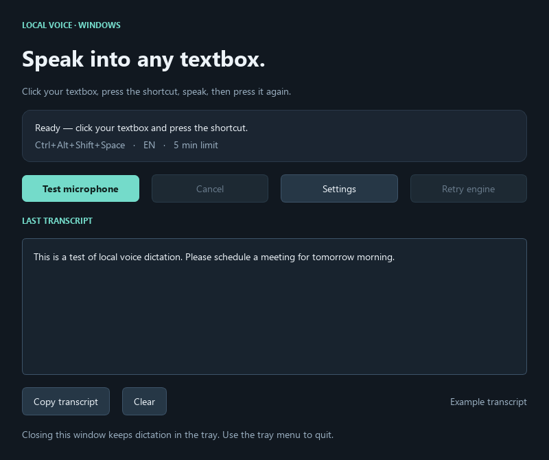

# Whistle Dictation

Local speech-to-text for Windows. Click a textbox, press **Ctrl+Alt+Shift+Space**,
speak, and press the shortcut again. Whistle transcribes your recording on the
CPU and the app types the completed text at your cursor.

**Version 0.1.0 · Initial experimental release · Windows AMD64**

[Download Windows release](https://github.com/smafnan/whistle-dictation/releases/latest)
· [User guide](docs/USER_GUIDE.md)
· [Report an issue](https://github.com/smafnan/whistle-dictation/issues)



## What it does

- Configurable global hotkey and a tray app that stays available when its window closes.
- Passive recording and processing indicator designed to leave your textbox focused.
- Local recognition in English, German, French, Spanish, Italian, Dutch, and Polish.
- Personal dictionary, exact word/phrase replacements, and conservative text cleanup.
- Automatic segmentation for longer recordings and a configurable recording limit.
- Cancellation and transcript recovery when recognition or insertion needs attention.
- Unicode text delivery that preserves your clipboard and never presses Enter.

This release implements dictation. Meeting captions, translation, speech-model
fine-tuning, and live incremental text are future work.

## Install

### Portable Windows release

1. Download `WhistleDictation-v0.1.0-windows-x64.zip` from
   [GitHub Releases](https://github.com/smafnan/whistle-dictation/releases/latest).
2. Extract the entire archive to a folder you can write to. Keep the executable,
   `_internal/`, `models/`, and supporting files together.
3. Open **WhistleDictation.exe** and wait for **Ready**.

No separate Python installation or GPU is required. The portable build is unsigned.
The release includes `SHA256SUMS.txt`; use `Get-FileHash -Algorithm SHA256` to
compare your downloaded archive with its recorded hash. See the
[portable instructions](docs/PORTABLE.md) for the folder layout.

### Run from source

Use a Windows desktop session, a microphone, and **64-bit Python 3.12**. The initial
build and runtime were validated on Windows 11 AMD64. ARM64 runtime artifacts exist,
but ARM64 execution has not been validated by this project.

Clone the repository into a writable directory, open PowerShell there, and run:

```powershell
git clone https://github.com/smafnan/whistle-dictation.git
Set-Location whistle-dictation
powershell -NoProfile -ExecutionPolicy Bypass -File .\Setup.ps1 -SkipDev
.\Run.cmd
```

Setup creates `.venv/`, installs the locked dependencies, downloads the pinned
Whistle model and native runtime, verifies their hashes, and runs a runtime check.
Internet access is needed for setup; normal dictation uses the local artifacts.
The model is about 17 MB, while Qt, Python, and other dependencies make the full
application considerably larger. Omit `-SkipDev` to install development tools too.

## First dictation

1. In the app, click **Test microphone**, speak a short sentence, and click
   **Stop recording**. Review the transcript; this test never types into another app.
2. Open Notepad and click inside its text area.
3. Press **Ctrl+Alt+Shift+Space**, speak, then press it again and release the keys.
4. Keep the same field focused until processing completes and your text appears.

Open **Settings** to choose your microphone, language, shortcut, and vocabulary.
If Windows reports that the shortcut is unavailable, choose another. Closing the
window keeps the app running in the tray; use the tray menu's **Quit** to exit.

Read the [user guide](docs/USER_GUIDE.md) for daily use, settings, cancellation, and
recovering a transcript. Use [troubleshooting](docs/TROUBLESHOOTING.md) for setup,
microphone, shortcut, and insertion problems.

## Privacy and local storage

The app does not save microphone recordings or transcript history during normal
dictation. Audio and the latest transcript are held in memory. Recognition uses
local model files; the runtime is configured for offline operation and publisher
telemetry is disabled.

`data/settings.json` stores your settings, dictionary, and replacements.
`data/app.log` contains bounded, rotating operational logs such as durations,
character counts, and error categories, without speech text, audio, dictionary
entries, or window titles. Source installs keep `data/` in the project; portable
installs keep it beside the executable. These local files are excluded from Git.

Automatic insertion does not modify the clipboard. **Copy transcript** intentionally
replaces its contents, and the destination application's own storage rules apply
to text you insert. The app does not configure Windows startup.

## Current limits and validation

The app inserts text only after transcription of the complete recording. Longer
audio is divided into clips of at most 28 seconds, then combined for delivery.
Recording ends at the configured limit (five minutes by default) or a 96 MB raw
sample budget. That budget is not the application's total memory usage.

Insertion checks the foreground window, focused native control, and process.
Browser and Electron fields can share native handles, so switching visual fields
within a window is not reliably detected. Some applications, especially elevated
ones, reject simulated Unicode input. A successful Windows input call also does
not prove that the receiving field accepted all characters. Review the destination
before copying after partial delivery.

The initial build passed **156 automated tests and 19 subtests**, native model
diagnostics, synthetic speech recognition, and source/portable startup checks.
Live microphone quality and actual insertion into your intended applications
remain desktop acceptance work. Those results are recorded in the
[validation record](docs/VALIDATION.md), with a reproducible manual checklist in
[acceptance](docs/ACCEPTANCE.md). No personal-voice accuracy or latency guarantee
is established by the synthetic speech results.

## Documentation and development

| Document | Purpose |
| --- | --- |
| [User guide](docs/USER_GUIDE.md) | Daily workflow, settings reference, privacy, and transcript recovery |
| [Troubleshooting](docs/TROUBLESHOOTING.md) | Diagnose setup, device, shortcut, and text-delivery failures |
| [Development guide](docs/DEVELOPMENT.md) | Source setup, tests, diagnostics, and portable builds |
| [Architecture and delivery plan](docs/ARCHITECTURE.md) | Components, lifecycle, design decisions, and future validation |
| [Acceptance checklist](docs/ACCEPTANCE.md) | Application compatibility, live speech, and performance evaluation |
| [Validation record](docs/VALIDATION.md) | Measured results and outstanding manual checks |
| [Runtime findings](docs/runtime-findings.md) | Pinned Whistle API, artifacts, hashes, and integration constraints |
| [Third-party components](THIRD_PARTY.md) | Dependency attribution and bundled license resources |

For development, run `Setup.ps1` without `-SkipDev`, then follow the
[development guide](docs/DEVELOPMENT.md). This project integrates Cactus Whistle;
it is an independent Windows application.

## License

Application source is released under the [MIT License](LICENSE). Third-party
libraries and model weights retain their own licenses; see
[THIRD_PARTY.md](THIRD_PARTY.md) and the release's bundled `licenses/` resources.
