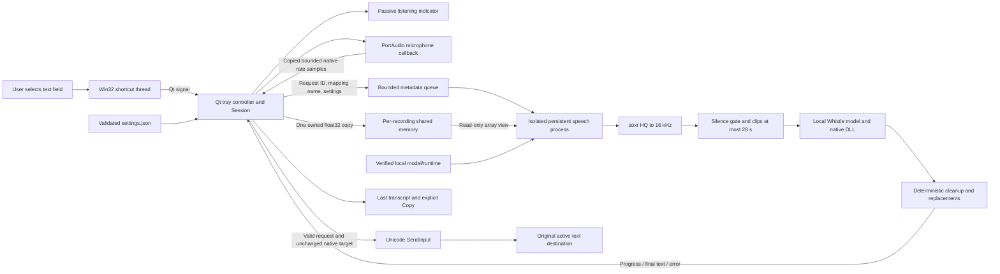
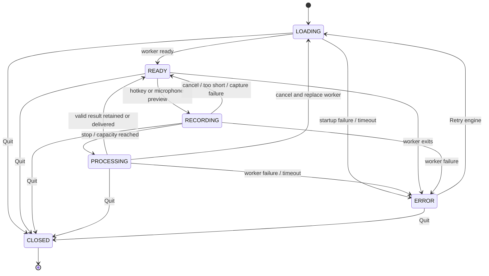

# Whistle Dictation architecture and delivery plan

Baseline: 5 October 2026. This document describes the implemented Windows
dictation prototype and the work required to establish reliable use on the
intended computer. Implementation and automated contracts are distinct from
microphone quality and application compatibility, which require desktop trials.

Final source validation passed 156 tests plus 19 subtests in 3.80 seconds;
Ruff and dependency checks were clean. The final rebuilt Windows AMD64 portable
executable passed doctor and offscreen smoke checks. These checks include the
current shared-memory transport and settings guards. Detailed verification is
recorded in [VALIDATION.md](VALIDATION.md).

## Product contract

The primary interaction is: select a text field, press the global shortcut,
speak, press the shortcut again, and receive the final transcript in that same
destination. The application stays in the Windows notification tray. A passive
indicator shows listening and processing without deliberately activating a
window. Recognition runs locally after explicit setup downloads.

The first release processes completed recordings. It supports configurable
language, microphone, shortcut, personal dictionary, deterministic phrase
replacements, and optional punctuation cleanup. Whistle supports English,
German, French, Spanish, Italian, Dutch, and Polish; automatic detection is
available. Translation and the separate meeting-caption product belong to a
later application.

| Requirement | Implemented behavior | Owner |
| --- | --- | --- |
| R1: Global toggle shortcut | Default `Ctrl+Alt+Shift+Space`; configurable; native registration reports conflicts | `win32.py`, `app.py` |
| R2: Preserve target focus | Capture original native foreground/control/process; indicator requests no focus | `win32.py`, `ui.py` |
| R3: Bounded microphone capture | Native-rate mono float32; duration and sample budget; automatic stop on capacity | `audio.py`, `app.py` |
| R4: Offline speech recognition | Explicit local weights/DLL; one persistent serialized worker | `runtime.py`, `engine.py` |
| R5: Long recordings | Resample once to 16 kHz; exact sample coverage in clips of at most 28 seconds | `audio.py`, `engine.py` |
| R6: Insert final text | Unicode `SendInput`; check unchanged focus before/after bounded batches | `win32.py`, `app.py` |
| R7: Controlled failure | Keep transcript for review; avoid automatic retries after partial insertion | `app.py`, `win32.py` |
| R8: Personal vocabulary | Forward decoding keywords; apply deterministic single-pass replacements | `config.py`, `text.py`, `engine.py` |
| R9: Cancellation | Discard capture or replace inference worker; invalidate request identity | `session.py`, `app.py`, `engine.py` |
| R10: Minimal retained data | Settings and operational logs on disk; latest transcript in memory | `config.py`, `app.py` |
| R11: Explicit lifecycle | Single instance; close window to tray; Quit releases devices/hotkey/worker | `__main__.py`, `app.py`, `win32.py` |
| R12: Reviewable evidence | Hardware-free tests, doctor, offscreen smoke check, desktop acceptance matrix | `tests/`, `__main__.py`, `ACCEPTANCE.md` |

## Component and execution boundaries



The Qt main thread owns widgets, session state, microphone lifecycle, response
polling, and text delivery. It polls every 100 ms. The hotkey listener owns its
Win32 message loop on a dedicated daemon thread and emits a Qt signal; it does
not manipulate widgets. PortAudio owns audio callbacks. Callbacks copy samples
from reusable device buffers under a lock and enforce capture limits, without
model calls or stream lifecycle operations.

The speech process starts using Windows-compatible `spawn`. It imports Needle
after configuring local paths and telemetry settings, verifies artifacts, and
loads one Whistle instance. It handles one recording at a time. Process
isolation contains a native crash and lets cancellation/timeout terminate an
unresponsive native call. The publisher runtime has global state and is not
thread-safe; using one serialized model process respects that constraint.

The request queue has one slot and the service rejects concurrent submissions.
The parent owns one shared-memory block for the active recording and copies
validated contiguous float32 audio into it once. The queue carries only the
mapping name, sample count/rate, overflow flag, settings, and unique recording
ID. The worker attaches a read-only NumPy view and closes that attachment before
sending a final result or error. The parent releases its allocation after a
matching result/error or failed submission; cancellation, timeout, crash, and
shutdown terminate/join the child before releasing active audio. Queue teardown
also closes the parent's unused reader before scheduling feeder shutdown so
blocked metadata writes can finish after worker termination, waits up to
0.5 seconds for the feeder, and closes the writer once it has stopped.

Progress updates and final results are accepted only while the controller is
processing that same recording ID. Native target handles remain in the UI
process; the worker has no text-delivery capability. Audio is not serialized
through `multiprocessing.Queue`. A concrete large-audio cancellation stress
found that this older approach could strand a feeder thread and retain its
audio buffer, which motivated the shared-memory transport.

## Session lifecycle



At recording start the controller captures the target and snapshots settings.
Changes apply to the next recording. A recording below 150 ms is discarded.
The preview button records without an insertion target, so the result remains
in the app for inspection. Repeated shortcuts during processing are rejected
with a status notice rather than starting another capture.

Recording cancellation aborts the microphone and discards its buffers.
Processing cancellation clears the target/ID, destroys the worker, releases
shared audio and queues, and loads a new worker. The app remains unavailable
until that worker reports
ready. A timeout or crash enters `ERROR`; Retry engine starts a fresh worker.
If initial shortcut registration conflicts, settings and microphone preview
remain available so another shortcut can be chosen. Startup has a 90-second
service deadline; per-recording inference defaults to
180 seconds and settings permit 15–600 seconds.

Closing the main window hides it; the tray app continues running. Quit closes
the session, unregisters the shortcut, discards active capture, terminates the
worker, and hides the tray. A named per-Windows-session mutex prevents duplicate
instances. Installation does not add a startup task or run the app at boot.

## Audio correctness and resource budget

`CapturedAudio` contains one-dimensional float32 samples, their original integer
sample rate, and an input-overflow flag. The recorder queries the selected
device's default rate and requests one input channel. It starts and stops the
device only around a recording. Callback and lifecycle locks prevent buffer
mutation during teardown. A stopped recorder releases chunk references;
failure paths close the stream. No audio file is written for normal dictation.

The effective capture length is:

```text
sample_count <= min(native_sample_rate * configured_seconds, 24,000,000)
native float32 sample storage <= 96,000,000 bytes
```

Settings expose 10–900 seconds, defaulting to 300. The absolute sample budget
can stop a high-rate microphone earlier: 24 million samples are 500 seconds at
48 kHz, or 125 seconds at 192 kHz. The UI reports that recording capacity was
reached and processes the retained audio. The 96 MB bound covers raw samples;
chunk-object overhead, transient concatenation, the shared-memory copy,
validation/resampling buffers, per-clip native conversion, Qt, and model
allocations add to process memory. The worker views shared pages rather than
receiving a separately serialized native-rate array. Capture and shared-memory
copy can coexist briefly, so shared transport still does not eliminate all
audio copies.
It is not a 96 MB total-application memory guarantee. At the default 300-second
limit and 48 kHz, native samples occupy about 57.6 MB.

Resampling happens once in the worker using soxr HQ. Whistle receives contiguous
mono float32 at 16 kHz. Its native limit is 480,000 samples, or 30 seconds. The
application uses at most 448,000 samples, or 28 seconds, for margin.

For each full clip, segmentation searches its last three seconds for the
lowest-energy 200 ms window, sampled at 20 ms intervals. It places the cut at
the window midpoint and prefers the latest tie. A cut cannot occur before
eight seconds into a full clip. Every input sample belongs to exactly one
segment, including a short final tail, with no overlap or dropped samples.
This reduces cuts inside speech; it does not ensure sentence or word boundaries.
The model may still miss a word divided by a cut. Only the application sample
coverage is guaranteed by tests.

Silence detection checks overlapping 100 ms windows with a 50 ms step and a
default RMS threshold of 0.001, approximately -60 dBFS. Short quiet speech does
not disappear into a whole-recording average. This is a conservative amplitude
gate rather than voice activity detection; quiet speech and background noise
need evaluation on real devices. Entirely silent recordings skip inference;
silent clips are skipped while progress still tracks segmentation.

Input overflow preserves the transcript for manual review and suppresses
automatic insertion. If any segment fails or returns invalid output, the whole
recording returns an error; an incomplete combined transcript is not inserted.

## Text delivery and focus boundaries

The original target records the root foreground HWND, focused child HWND, and
process ID. Target capture rejects absent focus, unrelated controls, and active
native menus/move loops. Before delivery, and before/after each bounded input
batch, the adapter verifies that both windows still exist, the root remains
foreground, child focus matches, ownership matches, and process identity has
not changed. It does not deliberately activate or restore another window.

Input uses UTF-16 Unicode packets via `SendInput`, with bounded batches of at
most 128 code units and supplementary-character surrogate pairs kept together.
It waits up to 1.5 seconds for Ctrl/Alt/Shift/Windows modifiers to be released.
It emits text key events, with no Enter, Tab, shortcut, or paste operation.
Normal automatic delivery preserves the clipboard. Explicit Copy intentionally
replaces clipboard text. Cleanup removes control characters before and after
replacements; the native adapter rejects unsafe controls and invalid surrogates
before producing events.

Failure retains the transcript in the app. A partial `SendInput` result is
reported without automatic retry because retry could duplicate a delivered
prefix. Windows can block input into elevated applications. Successful event
queueing is not proof that a particular editor accepted the text.

These checks operate at the Windows native-control level. Browsers and Electron
apps can use the same HWND for multiple visual text fields, browser tabs, or
document contents. Moving between such fields may evade the native focus check.
The app also does not inspect semantic editability or password-field state.
Focus checks and `SendInput` are separate operations, so a remaining race exists
between validation and delivery; there is no atomic Windows transaction here.
Stay in the selected field while a recording processes. Application-specific
UI Automation or browser integration would be a separate hardening phase.

## Configuration, artifacts, and data handling

The app root defaults to the repository directory in development and the
executable directory for a packaged build. A `--root` argument selects a
different portable root.

| Path beneath root | Purpose | Retention |
| --- | --- | --- |
| `models/whistle.cact` | Verified model weights | Persist until removed |
| `models/libneedle.dll` | Extracted architecture-specific native runtime | Persist until removed |
| `models/manifest.json` | Revisions, architecture, artifact hashes | Persist until removed |
| `.cache/` | Setup downloads and development test artifacts | Local cache |
| `data/settings.json` | Shortcut, device, language, dictionary, formatting, timeout | Persisted after explicit Save |
| `data/app.log` and backups | Operational status, durations, character counts, exception classes | Rotating: 256 KB plus two backups |

The settings loader rejects unknown fields and validates resource limits,
supported languages, dictionary contents, and replacement contents. Save writes
and flushes a temporary UTF-8 JSON file, then atomically replaces the previous
file. Changing a shortcut registers the new shortcut before releasing the old
one; a failed registration/save leaves the previous shortcut available.

Normal dictation keeps audio only in process memory and displays the latest
transcript in memory until replaced, cleared, or closed. Application operational
logs exclude transcripts, samples, dictionary phrases, and window titles.
Transcript Copy is an explicit user action. The command-line WAV transcription
mode prints its result to stdout; redirecting it is a separate chosen retention
path. The app does not automatically import existing meeting recordings.

Setup fetches the pinned `cactus-needle==3.1.0` native wheel and Whistle weights
using immutable publisher revisions and expected SHA-256 hashes. Downloads use
partial files and activate only after verification. The DLL is extracted from
its exact expected archive member. The manifest records the installed library
digest, and startup rechecks weights/library bytes against pinned expected
hashes and checks architecture. See
[runtime findings](runtime-findings.md) for artifact identities and sources.

Before Needle import/model creation the runtime sets `NEEDLE3_LIB_PATH` and
explicit local weights, plus `NEEDLE_TELEMETRY=0`, `DO_NOT_TRACK=1`,
`HF_HUB_DISABLE_TELEMETRY=1`, and `HF_HUB_OFFLINE=1`. Runtime operation requires
no transcription service or API key. Setup still needs the network. These
settings are not a firewall sandbox; offline operation should also be tested
with connectivity disabled.

## Delivery phases and release gates

| Phase | Deliverable and rationale | Current state | Exit evidence |
| --- | --- | --- | --- |
| 0: Integration contract | Verify actual Windows wheel, architecture, API, sample limit, and offline overrides | Implemented; Windows AMD64 native doctor verified | Pinned artifacts and `runtime-findings.md`; doctor loads model and recognizes synthetic silence |
| 1: Native adapter | Shortcut registration, stable native target capture, Unicode delivery, single instance | Implemented; fake-native contracts and real hotkey startup verified | Real Notepad/browser/editor insertion trials remain |
| 2: Audio pipeline | Native-rate capture, bounded storage, overflow, resampling, exact segmentation | Implemented; 25 audio tests verified | Synthetic tests plus live microphone/device trials |
| 3: Speech service | Persistent serialized model worker, owned shared audio, request identity, deadlines, crash recovery | Implemented; native recognition and shared-memory cancellation stress verified | Repeated live dictation/native desktop cancellation trials remain |
| 4: Tray product | Settings, passive indicator, preview, transcript recovery, cancel/retry/quit | Implemented; controller tests and source/packaged offscreen smoke verified | Manual desktop interaction remains |
| 5: Target-machine acceptance | Evaluate own voice and actual applications, calibrate latency and memory | Manual/data evaluation outstanding | Completed `ACCEPTANCE.md` matrix and 100–200-clip scorecard |
| 6: Distribution | Repeatable setup/launch/doctor and optional packaged build | Final portable AMD64 executable rebuilt; packaged doctor/offscreen smoke verified | Clean-machine install rehearsal and ARM64 validation remain |
| 7: Recognition adaptation | Fix vocabulary or recurring recognition gaps using evidence | Future; baseline required first | Held-out comparison improves measured errors without regression |

The prototype is ready for controlled local evaluation once setup and doctor
succeed. It is not yet established as compatible with every Windows textbox.
Live microphone capture and native insertion acceptance remain outstanding
until their dedicated trials are recorded.

## Known risks and next decisions

| Risk | Current containment | Next evidence or change |
| --- | --- | --- |
| Recognition errors in accent, noise, names, or numbers | Explicit language, personal dictionary, preview | Baseline dataset and critical-token score |
| Semantic focus changes under one browser/Electron HWND | Native identity checks; retain result on detected changes | Manual same-window tests; evaluate UI Automation/browser integration |
| Partial or rejected keyboard delivery | No automatic retry; full transcript available for review | Native app matrix and integrity-level checks |
| Callback/device loss | Overflow flag, bounded recording, stream cleanup | Disconnect/reconnect and permission-denial trials |
| Native engine crash or hang | Isolated worker, deadlines, retry | Repeated native sessions and resource stress |
| Peak process memory exceeds raw sample budget | 24-million-sample cap, single active request, owned shared-memory audio | Measure process working sets/private commit, transient copies, and mapping release |
| Clip boundary truncates a word | Low-energy boundary selection, no repeated overlap | Boundary-focused speech corpus and human review |
| Quiet phrase passes/fails RMS gate incorrectly | Short-window conservative gate | Microphone/noise calibration; optional dedicated VAD later |
| Shortcut conflict or device index changes | Clear registration failure and device choice | Startup/hot-plug trials; friendly device identity persistence later |
| Package/runtime changes | Pinned version, revisions, integrity checks | Deliberate upgrade with repeat acceptance |

Use decoding keywords and phrase replacements before considering model
training. They have different effects: keywords influence recognition;
replacements change the resulting text deterministically. Speech adaptation
requires a verified Whistle audio/transcript training and export path, which
this project has not established. Needle's text/tool-call fine-tuning workflow
does not provide that path. After collecting a baseline, isolate reproducible
speech errors, reserve speakers/sessions for held-out evaluation, and assess
training feasibility as a separate project. Meeting translation should reuse
tested capture/recognition pieces while adding its own audio transport and
translation architecture.
